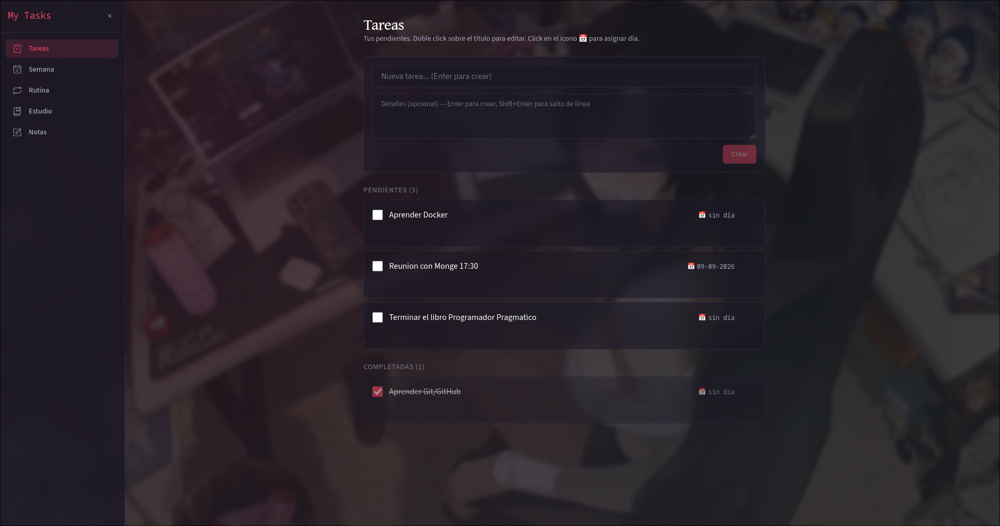
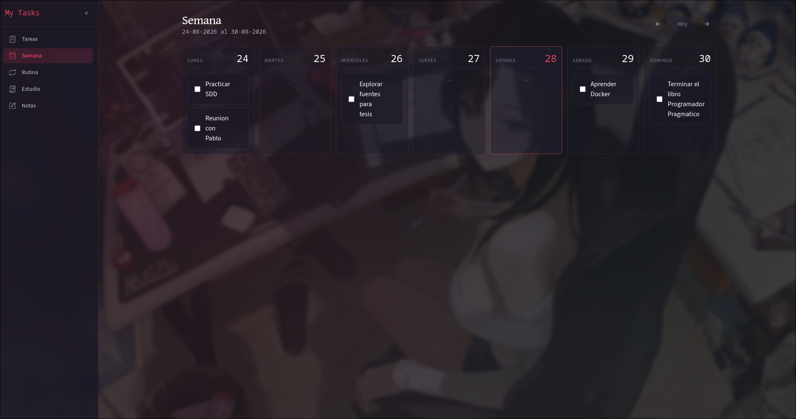
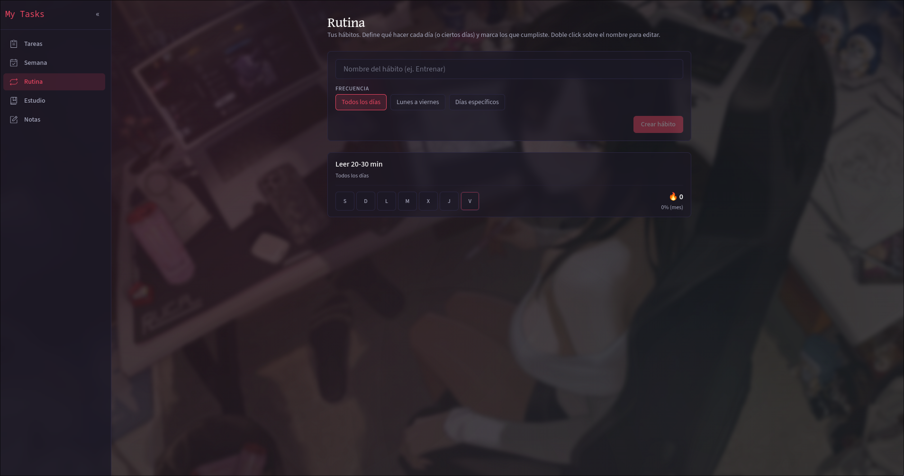
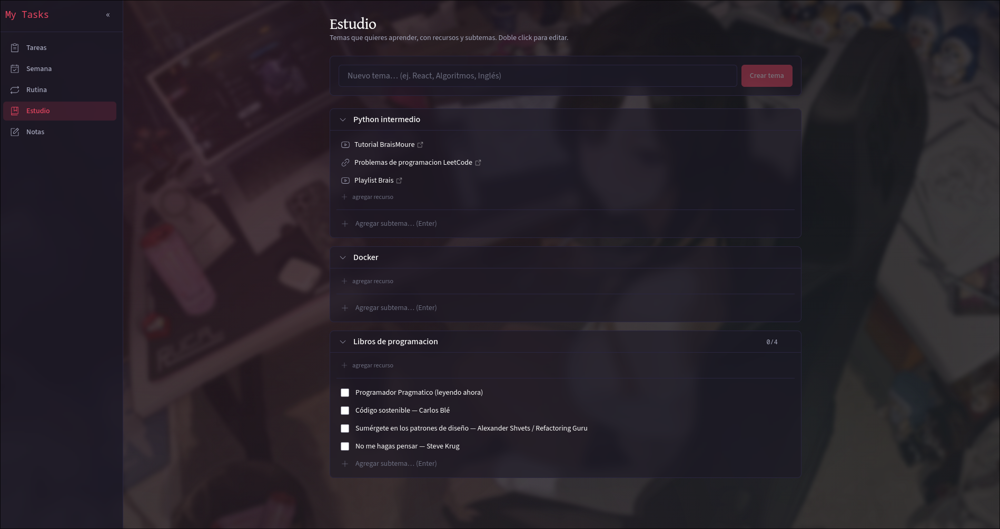
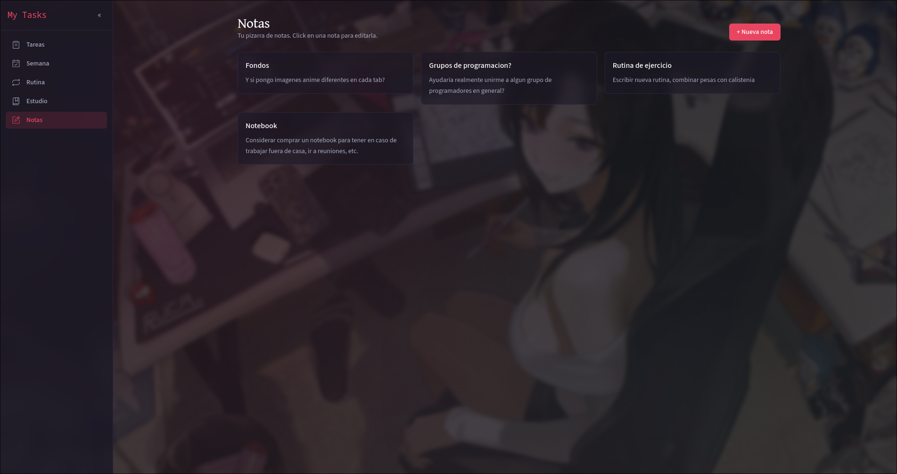

# My Tasks

Aplicación web fullstack para gestionar el día a día como desarrollador en formación: tareas pendientes, planificación semanal, hábitos, recursos de estudio y notas.

Construida desde cero como proyecto personal para practicar arquitectura fullstack real — API REST con Clean Architecture, SPA con Atomic Design, TypeScript estricto en ambos lados y persistencia progresiva (JSON → SQLite).

---

## Vistas

### Tareas
Pendientes y completadas. Creación rápida con título y detalle, asignación de fecha con selector inline.



### Semana
Vista semanal con navegación por semanas. Las tareas con fecha aparecen en su día correspondiente.



### Rutina
Tracker de hábitos con frecuencia configurable (diario, lunes a viernes, días específicos), marcado por día y porcentaje mensual.



### Estudio
Temas de aprendizaje organizados con subtemas, recursos vinculados (links, videos) e ítems con checkbox para libros y cursos.



### Notas
Pizarra de notas de texto libre, creación y edición inline.



---

## Stack

| Capa | Tecnologías |
|------|-------------|
| Frontend | Vite, React 19, TypeScript, Tailwind CSS v4, Zustand, React Router v7 |
| Backend | Node 20+, Express 5, TypeScript, Zod |
| Persistencia | Archivo JSON con escritura atómica (siguiente paso: SQLite/Postgres) |
| Testing | Vitest + Testing Library (frontend), Vitest + supertest (backend) |
| Tooling | ESLint, Prettier, EditorConfig, pnpm |

## Arquitectura

```
my-tasks/
├── backend/              API REST
│   └── src/
│       ├── domain/       entidades + interfaces (sin frameworks)
│       ├── application/  casos de uso
│       ├── infrastructure/ HTTP + persistencia (Express, JSON)
│       └── shared/       schemas Zod, utilidades
├── frontend/             SPA
│   └── src/
│       ├── components/   atoms / molecules / organisms / templates
│       ├── pages/        containers de cada vista
│       ├── hooks/        lógica reutilizable
│       ├── store/        Zustand stores
│       └── api/          cliente HTTP
└── scripts/              arranque unificado
```

---

## Setup

**Requisitos:** Node.js >= 20, pnpm >= 10

```bash
# Primera vez
cd backend  && pnpm install
cd ../frontend && pnpm install

# Arranque diario
./scripts/start-app.sh          # backend :4000 + frontend :5173
./scripts/start-app.sh --open   # abre el browser automáticamente
```

`Ctrl+C` apaga ambos procesos limpiamente.

<details>
<summary>Opciones alternativas de arranque</summary>

```bash
# Terminales separadas (debug)
cd backend  && pnpm dev
cd frontend && pnpm dev
```

Para Windows ver `scripts/windows/README.md`.
</details>

## Tests

```bash
cd backend  && pnpm test
cd frontend && pnpm test
```

---
